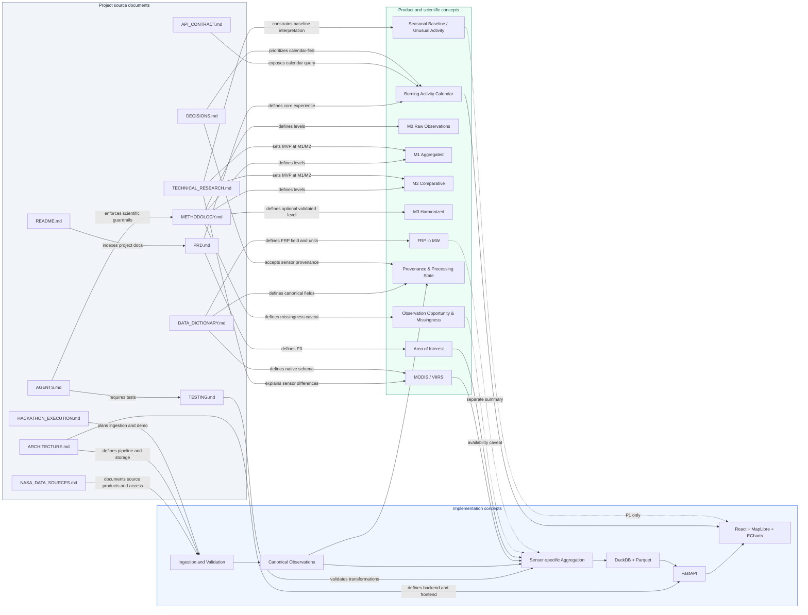
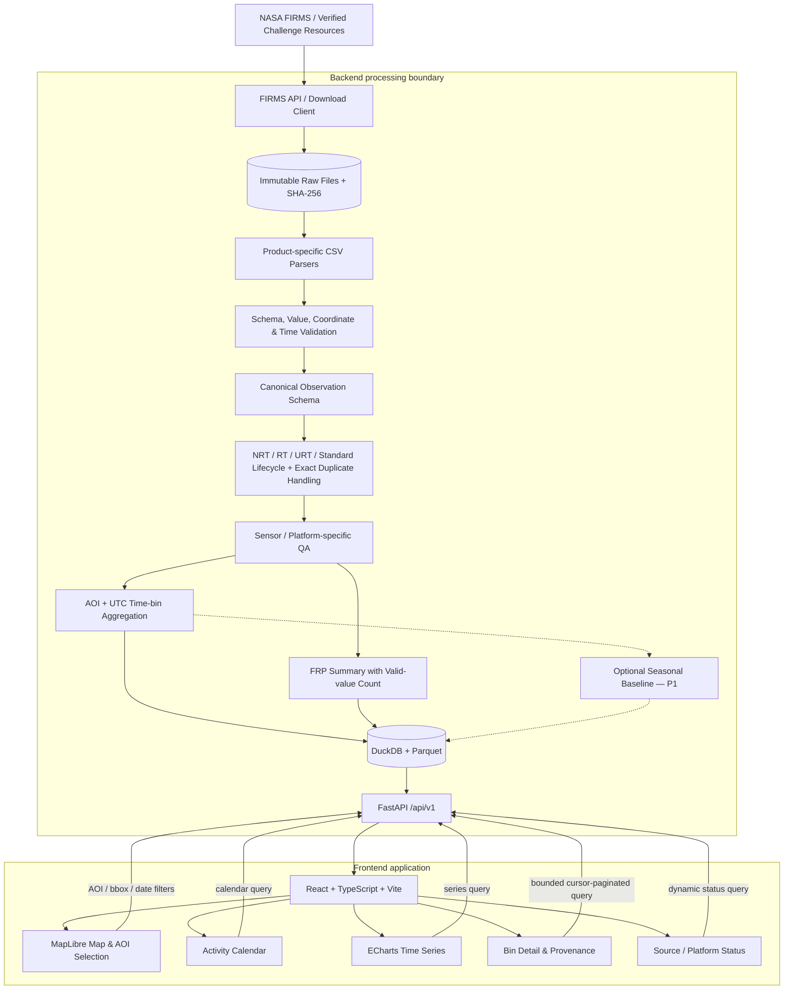
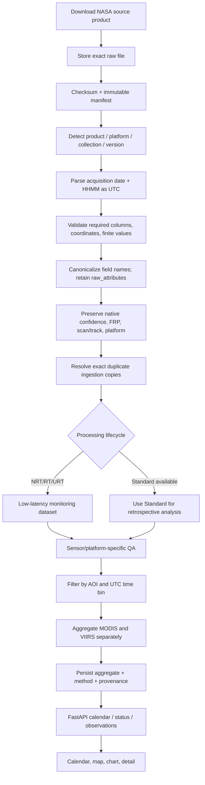
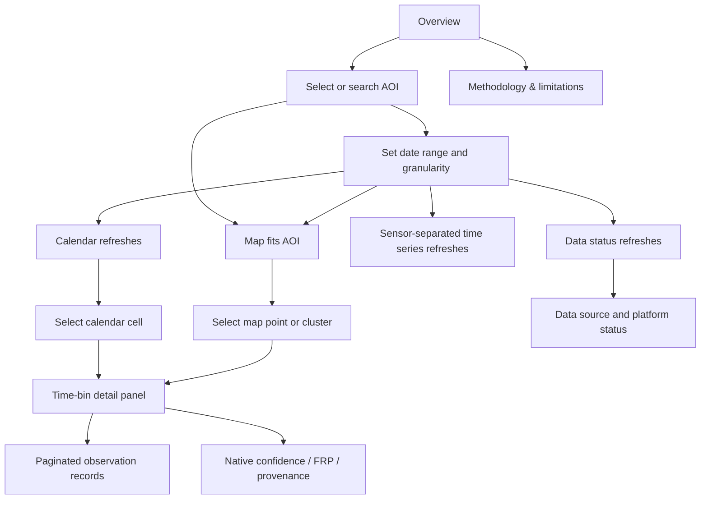

# FireScope — Project Graph View

This file is the readable, version-controlled graph specification derived from the supplied Markdown documents. It separates (1) documented knowledge relationships, (2) system architecture/data lineage, and (3) the UI navigation graph.

**Important:** this Markdown graph is a human-authored synthesis of the supplied documents. It is not represented as an already-generated Graphify `graph.json`/`graph.html`. The build prompt instructs the coding agent to run Graphify against the real workspace so its interactive graph and edge provenance are generated from the full corpus.

## 1. Knowledge graph — documents, requirements, and concepts

Solid edges represent relationships stated by the supplied docs. Dashed edges represent a design/implementation dependency inferred from combining those documents and should be verified against the real codebase.



## 2. System architecture graph



### 2.1 Key trust boundaries

- **NASA/source boundary:** raw source files are immutable, checksummed, and accompanied by source/product/collection/retrieval metadata.
- **Processing boundary:** parsers and canonicalization preserve the original native attributes; transformations are deterministic and method-versioned.
- **Scientific boundary:** MODIS and VIIRS stay separate through QA and aggregation. Pooled counts, if displayed, remain explicitly pooled observation records.
- **API boundary:** validate AOI/date inputs, preserve UTC, expose method/provenance, and paginate raw observations.
- **Browser boundary:** request bounded summaries; do not download all global raw observation points.

## 3. Data-flow and lifecycle graph



**Lifecycle rule:** do not add NRT and Standard copies of the same source observation as independent detections. Keep snapshot provenance for audit; use a documented supersession strategy and recompute affected aggregates idempotently.

## 4. UI interaction graph



## 5. Graphify knowledge-graph expectations

Run Graphify on the project documentation and implementation repository after the source documents are in the workspace.

Expected output folder: `graphify-out/`

| Output | Why it matters |
|---|---|
| `graph.html` | Interactive knowledge graph with searchable/filterable concepts and communities |
| `graph.json` | Persistent graph structure for future agent queries |
| `GRAPH_REPORT.md` | Central concepts, high-connectivity nodes, surprising links, and suggested questions |
| `wiki/` (optional) | Navigable Markdown articles grouped around concepts/communities |

Graphify edges must retain their origin labels:
- `EXTRACTED`: explicitly found in source files/code.
- `INFERRED`: plausible relationship suggested by extraction; verify before treating as a project fact.
- `AMBIGUOUS`: insufficient or conflicting source evidence; keep visible as unresolved.

Do not hand-edit `graph.json` to fabricate extraction provenance. Treat this document’s Mermaid diagrams as a readable architecture brief, and Graphify’s output as the actual generated knowledge graph.

### Useful Graphify queries after generation

- `What connects the PRD calendar-first requirement to the frontend components and API endpoints?`
- `Which scientific constraints affect each displayed metric?`
- `Where are MODIS and VIIRS kept separate throughout ingestion, QA, aggregation, and display?`
- `Which API fields are required to preserve source provenance in the selected-bin detail?`
- `Which assumptions or unresolved items are marked inferred or ambiguous?`

## 6. Archify diagram deliverables

Use Archify for system diagrams, not for the dashboard UI itself. Generate at minimum:

1. **Architecture diagram:** frontend, backend, NASA/source boundary, ingestion stages, storage, API, and user-facing modules.
2. **Dataflow diagram:** NASA source acquisition → immutable raw storage → parse/validate → canonicalize → lifecycle/QA → sensor-specific aggregation → persistence → API → UI.

Recommended artifact location:

```text
.archify/
  firescope-architecture/
    candidate.json
    firescope-architecture.html
  firescope-dataflow/
    candidate.json
    firescope-dataflow.html
```

The actual Archify candidate must follow the installed skill’s schema and pass its `finalize` validation/delivery/browser checks. Do not pretend a Mermaid diagram has been validated by Archify.

## 7. Provenance and open questions for the graph

- The complete client-rendered NASA Space Apps Resources-tab list still requires a human/browser verification step in the supplied research register.
- The exact AOI shape contract beyond `aoi_id` or `bbox` is not yet defined.
- Map tile source and license must be selected and attributed.
- Historical anomaly calculations depend on platform availability and processing-state continuity.
- The graph should be refreshed after meaningful source-doc or code changes; do not treat a stale graph as the latest architecture.
