<div align="center">

<br />


<h3>Active Fire Intelligence &amp; AOI Burning-Activity Calendar</h3>

<p>
  <strong>NASA Space Apps 2026:</strong> Harmonization of MODIS and VIIRS Hot Spots<br />
  React 19 · TypeScript · Vite · Tailwind CSS v4 · Leaflet · Express · DuckDB · Apache Parquet
</p>

<p>
  <a href="#1-challenge-problem-and-solution">Challenge Fit</a> ·
  <a href="#2-cross-sensor-harmonization-and-methodology">Harmonization Math</a> ·
  <a href="#3-verified-nasa-data-architecture">NASA Data Architecture</a> ·
  <a href="#4-workspace-capabilities">Capabilities</a> ·
  <a href="#5-system-architecture-and-repository-layout">Architecture</a> ·
  <a href="#6-setup-and-installation">Quickstart</a> ·
  <a href="#8-backend-api-overview">API</a>
</p>

</div>

---

| Dimension | Verified Baseline in This Repository |
|---|---|
| **Sensors & Platforms** | MODIS Collection 6.1 (`Terra`, `Aqua`) and VIIRS Collection 2 (`Suomi-NPP`, `NOAA-20`, `NOAA-21`) |
| **Historical Parquet Archive** | `8,913,218` deduplicated NASA FIRMS records (`2001-01-01` to `2026-11-12`, Indonesia `0.25 deg` daily grid) |
| **Global Presets NASA Archive** | `692,671` real NASA FIRMS Area API observations (`261,471` daily buckets across 4 global fire regimes, `2024` to `2026`) |
| **Live Global Feeds** | Real-time 24h NASA FIRMS CSV streams (`MODIS C6.1`, `VIIRS NOAA-20`, `NOAA-21`, `S-NPP`) + NASA EONET v3 wildfires |
| **Analytical Methods** | `M0_RAW`, `M1_AGGREGATED`, `M2_COMPARATIVE`, Spatiotemporal Co-Location, and gated `M3_EMPIRICAL_PLATFORM_BRIDGE` (off by default) |
| **Automated Test Suite** | `40 / 40` unit, DuckDB integration, and API regression tests passing in [`src/science/fireScience.test.ts`](./src/science/fireScience.test.ts) |

---

## 1. Challenge Problem and Solution

Comparing **MODIS (`~1 km` nadir)** and **VIIRS (`~375 m` I-band)** active-fire detections naively distorts trend analysis and incident reporting:

1. **Resolution Asymmetry:** VIIRS detects smaller and lower-intensity thermal anomalies than MODIS, causing raw detection counts to jump after VIIRS entered service (`2012-01-20`).
2. **Changing Constellation Size:** VIIRS coverage expanded from 1 satellite (`Suomi-NPP` in `2012`) to 3 concurrent satellites (`NOAA-20` in `2018-04-01`, `NOAA-21` in `2023-03-01`), then shifted again when `Suomi-NPP` archive data ended on `2026-11-02`.
3. **Incompatible Native Confidence Scales:** MODIS reports numeric confidence (`0` to `100`), whereas VIIRS Collection 2 reports categorical tiers (`low`, `nominal`, `high`).
4. **Hotspot vs. Fire Incident Conflation:** A satellite hotspot is an instantaneous thermal anomaly pixel at overpass time, and Fire Radiative Power (`FRP` in `MW`) is radiative heat rate rather than burned area or perimeter.

**FireScope** addresses these constraints as an Area-of-Interest (`AOI`) burning-activity calendar backed by DuckDB Parquet analytics, live NASA FIRMS streams, and transparent empirical cross-sensor harmonization:

| Scientific Failure Mode | FireScope Mitigation | Source Module |
|---|---|---|
| Raw summation across sensors treated as truth | Native MODIS and VIIRS tracks kept strictly separated (opt-in M3 bridge gated behind `ENABLE_EXPERIMENTAL_M3=true`) | [`harmonizationScience.ts`](./src/science/harmonizationScience.ts) |
| Multi-satellite launch inflation (`1` vs `3` VIIRS satellites) | Active constellation count divisor `K_s(t)` derived from official NASA service dates and active filters | [`harmonizationScience.ts`](./src/science/harmonizationScience.ts) |
| Duplicate or stale near-real-time records | Exact-identity `NRT -> STANDARD` supersession without aggressive spatial-proximity deletion | [`fireScience.ts`](./src/science/fireScience.ts) |
| Multi-pixel overcounting per burning zone | Adaptive Haversine + Union-Find co-location clustering grouping MODIS and VIIRS within `+/- 6h` UTC | [`harmonizationScience.ts`](./src/science/harmonizationScience.ts) |
| Silent zero vs. missing satellite ambiguity | Explicit coverage states (`AVAILABLE`, `PARTIAL_COVERAGE`, `NO_DETECTIONS_IN_AVAILABLE_RECORDS`, `NO_SOURCE_DATA`) | [`comparisonScience.ts`](./src/science/comparisonScience.ts) |
| Fabricated clear-sky or cloud-mask assumptions | Physical observation-probability fill (`M4`) remains disabled because FIRMS CSVs lack cloud masks and full swath geometry | [`server.ts`](./server.ts) |

---

## 2. Cross-Sensor Harmonization and Methodology

FireScope implements a transparent hierarchy of analytical methods rather than hiding assumptions behind black-box indices:

| Method ID | Role in Application | Status |
|---|---|---|
| `M0_RAW` | Exact canonical NASA FIRMS records preserving `latitude`, `longitude`, UTC `acq_datetime_utc`, native confidence, `scan`/`track`, `FRP (MW)`, and SHA-256 provenance | Active in Inspector & API |
| `M1_AGGREGATED` | Identical `WGS84` AOI filtering and UTC `day` / `week` / `month` bin aggregation computed separately per sensor and per satellite platform | Active Default |
| `M2_COMPARATIVE` | Synchronized side-by-side sensor displays, FR-08 like-for-like period comparisons, FR-09 `Median`/`MAD` seasonal anomaly detection, and Multi-AOI per-`1,000 sq km` rates | Active Default |
| `M3_EMPIRICAL_PLATFORM_BRIDGE` | Constellation-normalized empirical cross-sensor regression projecting VIIRS observations onto a 2-satellite MODIS-equivalent series with `80%` prediction intervals and holdout validation | Gated Research Extension (`ENABLE_EXPERIMENTAL_M3=true`, off by default per `D-004`) |
| `M3_SPATIOTEMPORAL_COLOCATION` | Adaptive Haversine spatial grid + Union-Find clustering (`FULL_BIN_POINTS` up to `25,000` points; `0.25 deg` `FULL_BIN_GRID_BUCKETS` beyond) separating co-detected MODIS+VIIRS events from `VIIRS-Only` and `MODIS-Only` | Active on Server API & `SelectedBinDetail` |
| `M4_PHYSICAL_OBS_PROBABILITY` | Clear-sky detection probability, pixel area growth modeling, and cloud-cover gap-filling requiring Level-2 swath and cloud products absent from FIRMS CSV feeds | Intentionally Disabled |

### Mathematical Pipeline in [`src/science/harmonizationScience.ts`](./src/science/harmonizationScience.ts)

1. **Active Constellation Normalization:** For each UTC time bin `t` and sensor `s in {MODIS, VIIRS}`, `getExpectedActivePlatforms` counts operational platforms `K_s(t)` respecting commission/decommission boundaries (`TERRA` from `2000-11-01`, `AQUA` from `2002-07-04`, `SNPP` `2012-01-20` to `2026-11-02`, `NOAA20` from `2018-04-01`, `NOAA21` from `2023-03-01`) as well as active user filters:
   ```text
   R_s(t) = Y_s(t) / K_s(t)
   ```
2. **Empirical Cross-Sensor Transfer Bridge:** Across active overlap bins (`MODIS > 0` and `VIIRS > 0` within the selected AOI and UTC window, requiring `>= 2` overlap bins), `computeHarmonizedSeries` fits an Ordinary Least Squares model in log space (`OLS_LOG_BRIDGE`) with a `ROBUST_MEDIAN_RATIO` fallback (`R_MODIS = R_VIIRS / kappa`):
   ```text
   ln(R_MODIS + 1) = alpha + beta * ln(R_VIIRS + 1)
   ```
   Predictions are scaled to a standardized 2-satellite MODIS-equivalent baseline (`bridged_modis_equiv`) accompanied by asymmetric log-residual **80% prediction intervals** (`bridged_lower_80`, `bridged_upper_80`).
3. **Out-of-Sample Error Evaluation:** When `>= 10` active overlap bins are available, the bridge evaluates chronological `70/30` holdout error (`CHRONOLOGICAL_70_30_HOLDOUT`); when `4` to `9` bins exist, it runs `LEAVE_ONE_OUT_CV`. Reported diagnostics include `log_pearson_r`, `log_r_squared`, `holdout_mae`, and `holdout_rmse`.
4. **Full-Bin Spatiotemporal Co-Location Concordance:** On `/api/v1/observations` and `/api/v1/analytics/calendar`, `queryParquetBinSpatialConcordance` evaluates 100% of observations in the selected bin via `clusterCrossSensorObservations` (`FULL_BIN_POINTS`, merging adjacent pixels within `max(1.5 km, min(2.5 km, 0.75 * max(scan, track, 1.0)))` and `+/- 6h` UTC up to `25,000` points) or `computeBucketSpatialConcordance` (`FULL_BIN_GRID_BUCKETS` across `0.25 deg` grid buckets for dense or pre-`2026-10-01` bins) to report `co_detected_clusters`, `viirs_only_clusters`, `modis_only_clusters`, and empirical co-detected `V:M` ratios without page truncation.
5. **Seasonal Baseline Anomaly (`FR-09`):** `computeSeasonalBaseline` computes per-sensor `robust_z = (x - median_baseline) / (1.4826 * MAD_baseline)`, filtering out pre-2012 years for VIIRS, falling back to percentile/delta ranks when `MAD_baseline = 0`, and flagging ongoing UTC months as `Incomplete UTC period`.

---

## 3. Verified NASA Data Architecture

All datasets in [`server.ts`](./server.ts) maintain strict date-boundary separation (`< liveCutoffDate` for historical archives, `>= liveCutoffDate` for live 24h CSV streams) so recent detections are never double counted.

### Multi-Tier Data Sources

| Layer | Backing Artifact / Endpoint | Scope & Date Bounds | Verified Volume & Provenance |
|---|---|---|---|
| **Historical Multi-Decade Archive** | [`data/processed/daily_aggregates.parquet`](./data/processed/daily_aggregates.parquet), [`recent_observations_2026.parquet`](./data/processed/recent_observations_2026.parquet), [`parquet_manifest.json`](./data/processed/parquet_manifest.json) | Indonesia extent (`95.02E..140.98E`, `11.00S..5.88N`, `EPSG:4326`), `2001-01-01` to `2026-11-12` | `8,913,500` raw CSV rows -> `8,913,218` canonical records (`282` exact duplicates removed): `2,955,260` daily `0.25 deg` buckets + `737,959` Oct-Nov 2026 records; SHA-256 recorded |
| **Global Reference Presets Archive** | [`data/processed/global_presets_nasa.json.gz`](./data/processed/global_presets_nasa.json.gz) via [`globalPresetsService.ts`](./src/services/globalPresetsService.ts) | 4 global regions across `2024-10-15..2024-11-14`, `2025-10-15..2025-11-14`, `2026-10-01..2026-11-15` | `692,671` canonical NASA FIRMS Area API v4 (`_SP`/`_NRT`) rows aggregated into `261,471` `0.25 deg` buckets and `24,970` sampled points |
| **On-Demand Area API (Optional)** | NASA FIRMS Area API v4 (`server.ts` + `.cache/firms_area_cache.json`) | Eligible custom/uncached non-Indonesia AOIs (capped at `45` days on-demand in live queries) | Requires server-side `FIRMS_MAP_KEY`; merges `_SP` and `_NRT` sources with `NRT -> STANDARD` deduplication |
| **Live 24h Global Streams** | [`firmsLiveService.ts`](./src/services/firmsLiveService.ts) & [`eonetLiveService.ts`](./src/services/eonetLiveService.ts) | Global real-time `MODIS C6.1`, `VIIRS NOAA-20`, `VIIRS NOAA-21`, `VIIRS S-NPP` (`0` rows post `2026-11-02`), plus EONET v3 wildfires | Synced dynamically with SHA-256 feed checksums; live 24h global streams (~100k detections/24h depending on active global fires) |
| **Unbacked Coverage Boundary** | [`comparisonScience.ts`](./src/science/comparisonScience.ts) & [`firescopeApi.ts`](./src/services/firescopeApi.ts) | Uncovered historical/global dates, offline client state, or pre-2012 VIIRS bins | Never falls back to synthetic samples (`ALL_ARCHIVE_OBSERVATIONS` is test-only); returns explicit `NO_SOURCE_DATA` / `PARTIAL_COVERAGE` states |

### Platform Breakdown in Verified Parquet Manifest

| Platform | Sensor & Product | First Date | Last Date | Canonical Records |
|---|---|---|---|---|
| **Terra** | `MODIS C6.1` (`MCD14ML/DL`) | `2001-01-01` | `2026-11-12` | `574,934` |
| **Aqua** | `MODIS C6.1` (`MYD14/MCD14ML`) | `2002-07-04` | `2026-11-12` | `1,121,904` |
| **Suomi-NPP** | `VIIRS C2` (`VNP14IMGTDL`) | `2012-01-20` | `2026-11-02` | `4,140,405` |
| **NOAA-20** | `VIIRS C2` (`VJ114IMGTDL`) | `2018-04-01` | `2026-11-12` | `1,970,210` |
| **NOAA-21** | `VIIRS C2` (`VJ214IMGTDL`) | `2023-03-01` | `2026-11-12` | `1,105,765` |

### Preset AOIs Built Into the Workspace

| AOI ID | Region | Area (`sq km`) | Primary Historical Data Source |
|---|---|---|---|
| `global-world` | Global World View (All Countries) | `510,072,000` | Global Presets NASA Archive (4 biomes) + Indonesia Parquet Archive (covered multi-year windows) + Live 24h NASA FIRMS global feeds |
| `indonesia-archipelago` | Indonesia Archipelago (Full Extent) | `1,904,569` | DuckDB Parquet (`2001` to `2026`, `8.91M` records) + Live 24h FIRMS |
| `kalimantan-peat` | Central Kalimantan Peatlands, Indonesia | `31,120` | DuckDB Parquet (`2001` to `2026`) + Live 24h FIRMS |
| `california-sierra` | Northern Sierra & Sacramento Foothills, USA | `24,180` | Real NASA Area Archive (`3,025` rows across Oct-Nov `2024..2026`) + Live/Area API |
| `para-amazon` | Tapajos-Xingu Corridor, Para, Brazil | `48,750` | Real NASA Area Archive (`40,954` rows across Oct-Nov `2024..2026`) + Live/Area API |
| `congo-zambezi-africa` | Congo Basin & Zambezi Savanna, Africa | `2,140,000` | Real NASA Area Archive (`633,723` rows across Oct-Nov `2024..2026`) + Live/Area API |
| `kakadu-savanna` | Arnhem Land & Kakadu Savanna, Australia | `36,040` | Real NASA Area Archive (`14,969` rows across Oct-Nov `2024..2026`) + Live/Area API |

### Scientific Guardrails & Honest Scope Boundaries

- **Confidence Semantics Preserved:** MODIS `0-100` numeric confidence and VIIRS `low | nominal | high` categories are filtered independently (`modis_min_confidence`, `viirs_categories`) and never forced onto a shared numerical score.
- **Pre-Aggregated Parquet FRP Semantics:** Multi-day/month Parquet aggregate bins compute exact `sum_mw`, `mean_mw`, and `max_mw`, returning `median_mw: null` and `p90_mw: null` (`N/A (daily agg)` in UI) rather than interpolating medians from pre-bucketed sums.
- **Known Scope Notes for Full Transparency:**
  - When selecting `global-world`, historical non-live calendar, YoY comparison, and observation queries combine the 4 seeded global preset archives (`692,671` records across `2024-10-15..2024-11-14`, `2025-10-15..2025-11-14`, and `2026-10-01..2026-11-15`) with Indonesia's `8.91M` Parquet archive across those covered multi-year windows (plus live 24h global feeds); dates outside covered global windows expose `coveredDateWindows` and report `NO_SOURCE_DATA` rather than false zero counts. Indonesia's full multi-decade Parquet timeline is also directly active for `indonesia-archipelago`, `kalimantan-peat`, and custom AOIs inside Indonesia (`isAoiInParquetCoverage`).
  - Map layers explicitly surface `spatial_provenance` (`FULL_ARCHIVE`, `PRESET_SAMPLE_INDEX`, `LIVE_STREAM`, `EONET_CONTEXT_ONLY`) so sampled global preset points or EONET overlays are never misread as full-density global inventories.
  - `generateProvenanceCsv` in [`src/services/firescopeApi.ts`](./src/services/firescopeApi.ts) and the hover/focus inspector in [`CalendarHeatmap.tsx`](./src/components/CalendarHeatmap.tsx) expose constellation-normalized per-satellite rates (`Y_s / K_s`, plus `modis_active_satellites` and `viirs_active_satellites` in CSV) alongside raw per-sensor counts; optional M3 columns (`m3_bridged_modis_equiv`, `m3_bridged_lower_80`, `m3_bridged_upper_80`, `m3_bridged_source`, `m3_viirs_calibrated_modis_equiv`) and M3 Bridge inspector readouts are emitted only when `analytics.harmonization` is active (`ENABLE_EXPERIMENTAL_M3=true`).

---

## 4. Workspace Capabilities

- **Map Explorer ([`MapCanvas.tsx`](./src/components/MapCanvas.tsx), [`ToolPanels.tsx`](./src/components/ToolPanels.tsx)):**
  - Horizontally wrapped Leaflet `EPSG:4326` world map supporting preset AOIs, custom bounding-box (`BBOX`) and polygon drawing, geodesic distance/area measurement, and `localStorage` Saved AOIs ([`savedAois.ts`](./src/utils/savedAois.ts)).
  - Switchable `Points`, `Grid`, and `Cluster` spatial display modes (`0.25 deg`, `0.5 deg`, `1.0 deg`, `2.0 deg`), Solar Terminator day/night overlay, verified offshore marine flare mask (`exclude_offshore`), and NASA EONET v3 wildfire context markers.
- **AOI Burning-Activity Calendar & Diagnostics ([`CalendarHeatmap.tsx`](./src/components/CalendarHeatmap.tsx), [`SensorComparisonChart.tsx`](./src/components/SensorComparisonChart.tsx), [`SelectedBinDetail.tsx`](./src/components/SelectedBinDetail.tsx)):**
  - Synchronized UTC filtering with quick presets (`TODAY (UTC Live)`, `24HRS (Live NASA FIRMS)`, `Oct-Nov 2026 Daily`, `2024-2026 Monthly`, `2015 El Nino (Monthly)`) across `day`, `week`, and `month` granularities and `detection_count` or `frp_mw` metrics.
  - `SensorComparisonChart` defaults strictly to `Sensor Series (MODIS vs VIIRS)` and `5-Platform Split` (exposing `Harmonized Bridge (M3)` only when `ENABLE_EXPERIMENTAL_M3=true`).
  - `SelectedBinDetail` & `ObservationInspector` expose native confidence values, per-sensor FRP summaries, `Cross-Sensor Co-Location` cluster breakdowns, paginated individual detections, and SHA-256 provenance.
- **Historical & Multi-Region Comparison ([`ComparisonPanels.tsx`](./src/components/ComparisonPanels.tsx)):**
  - **Compare History (`FR-08`):** Like-for-like UTC window comparison (`2015` vs `2023`, `Jul-Nov 2025` vs `2026`, or custom windows) with leap-day (`02-29`) alignment, constellation-normalized per-satellite rates (`Y_s / K_s`), multi-year YoY tables, era-transition warnings, and CSV export.
  - **Compare Regions:** Side-by-side comparison of two AOIs over identical UTC windows showing both raw counts and area-normalized detections per `1,000 sq km` with unequal-area cautions.
- **UI Architecture & UX Reliability ([`GlobalHeader.tsx`](./src/components/GlobalHeader.tsx), [`ProgressiveDisclosure.tsx`](./src/components/ProgressiveDisclosure.tsx), [`ReferencePages.tsx`](./src/components/ReferencePages.tsx)):**
  - Light (`Field Atlas`) and Dark (`Night Orbit`) themes defined via CSS custom properties in [`src/index.css`](./src/index.css).
  - Progressive disclosure via accessible `InfoPopover` and `DisclosureAccordion` components, inline error-recovery banners (`Retry query` preserving last snapshot), built-in `Sources` / `Methods` / `About` reference routes, and URL query-state sharing.

---

## 5. System Architecture and Repository Layout

<div align="center">
  
  <br />
  <sub>Vector architecture export from <a href="./public/brand/firescope-architecture-dark.html">public/brand/firescope-architecture-dark.html</a> (Night Orbit dark palette, WCAG AA contrast verified).</sub>
</div>

<br />

<details>
<summary>Inspect tracked repository layout (49 tracked files)</summary>

```text
.
├── .env.example                           # Environment variable template (APP_URL, FIRMS_MAP_KEY, PORT, CORS_ALLOWED_ORIGIN, ENABLE_EXPERIMENTAL_M3)
├── .gitignore
├── README.md
├── bun.lock
├── index.html                             # App shell + SVG browser favicon links
├── metadata.json                          # Application title & description metadata
├── package.json                           # Dependencies and npm scripts (dev, start, build, lint, test)
├── server.ts                              # Express + Vite server (port 3000) and REST API (/api/v1/*)
├── tsconfig.json                          # Strict TypeScript compiler config
├── vite.config.ts                         # Vite + React + Tailwind CSS v4 config
├── public/
│   └── brand/
│       ├── firescope-icon.svg             # 1:1 faceted flame favicon mark
│       ├── firescope-wordmark.svg         # Theme-adaptive wordmark SVG (prefers-color-scheme)
│       ├── firescope-lockup.svg           # Combined icon + wordmark SVG
│       ├── firescope-architecture-dark.html # Editorial system architecture diagram source (Night Orbit dark HTML)
│       └── firescope-architecture-dark.svg  # Standalone exported dark vector architecture diagram for README
├── scripts/
│   ├── buildParquet.ts                    # DuckDB ETL rebuilding data/processed/*.parquet from local data/raw/*.zip
│   └── fetchGlobalPresetsNasa.ts          # Area API fetcher generating data/processed/global_presets_nasa.json.gz
├── data/
│   └── processed/
│       ├── daily_aggregates.parquet       # 2,955,260 daily 0.25 deg buckets (Indonesia 2001-2026)
│       ├── recent_observations_2026.parquet # 737,959 Oct-Nov 2026 canonical records
│       ├── parquet_manifest.json          # Spatial extent, platform bounds, and SHA-256 checksums
│       └── global_presets_nasa.json.gz    # 692,671 real NASA Area API records across 4 global fire biomes
└── src/
    ├── App.tsx                            # Root workspace layout, routing, modals, and error recovery banner
    ├── main.tsx                           # React 19 entrypoint
    ├── index.css                          # Light (Field Atlas) & Dark (Night Orbit) tokens + Tailwind v4
    ├── hooks/
    │   └── useFireScopeWorkspace.ts       # Synchronized query state, API fetching, and workspace orchestration
    ├── types/
    │   └── firescope.ts                   # Shared strict TypeScript contracts for client & server
    ├── science/
    │   ├── fireScience.ts                 # M0/M1 UTC parsing, AOI bounds, NRT->STD supersession, FRP, offshore mask
    │   ├── comparisonScience.ts           # M2 FR-08 YoY, FR-09 Median/MAD, Multi-AOI comparison, grid aggregation
    │   ├── harmonizationScience.ts        # M3 K_s(t) normalization, OLS log bridge, holdout eval, co-location
    │   └── fireScience.test.ts            # 40 automated unit, DuckDB, and API regression tests
    ├── services/
    │   ├── parquetService.ts              # DuckDB read-only queries over data/processed/*.parquet
    │   ├── globalPresetsService.ts        # In-memory loader and queries over global_presets_nasa.json.gz
    │   ├── firmsLiveService.ts            # 24h FIRMS CSV + Area API (_SP/_NRT) ingestion and caching
    │   ├── eonetLiveService.ts            # NASA EONET v3 wildfire event ingestion
    │   └── firescopeApi.ts                # Typed frontend API client and CSV provenance exporter
    ├── data/
    │   └── firmsArchiveData.ts            # Preset AOIs, NASA platform registry, and unit-test fixture baseline
    ├── utils/
    │   └── savedAois.ts                   # LocalStorage CRUD helpers for custom Saved AOIs
    └── components/
        ├── BrandLogo.tsx                  # Adaptive FireScopeMark, FireScopeWordmark, FireScopeHeaderBrand, FireScopeLockup
        ├── GlobalHeader.tsx               # Top bar navigation, live status pill, theme toggle, help modal trigger
        ├── PrimaryNavigationDrawer.tsx    # Responsive slide-over navigation and quick region selector
        ├── ProgressiveDisclosure.tsx      # Accessible click/escape-managed InfoPopover and DisclosureAccordion
        ├── MapCanvas.tsx                  # Leaflet interactive map, BBOX/polygon drawing, grid/cluster layers
        ├── ToolPanels.tsx                 # AOI selector, filter drawer, synchronized UTC timeline controls
        ├── CalendarHeatmap.tsx            # Daily/weekly/monthly burning-activity calendar heatmap
        ├── SensorComparisonChart.tsx      # Sensor and 5-Platform chart views (plus gated M3 bridge when enabled)
        ├── SelectedBinDetail.tsx          # Bin breakdown, FRP distribution, and full-bin Co-Location clusters
        ├── ObservationInspector.tsx       # Individual pixel inspection modal/drawer with native fields & checksums
        ├── ComparisonPanels.tsx           # Historical Period (FR-08) and Multi-AOI comparison views
        └── ReferencePages.tsx             # Data Sources, Methodology & Limitations, and About FireScope views
```

</details>

---

## 6. Setup and Installation

### Prerequisites

- **Node.js** `>= 20.x`
- **npm** (or `bun`, lockfile included)
- Optional: **NASA FIRMS `MAP_KEY`** ([NASA FIRMS Area API](https://firms.modaps.eosdis.nasa.gov/api/area/)) for on-demand historical Area API queries beyond the pre-bundled Indonesia Parquet and Global Presets archives. Without `FIRMS_MAP_KEY`, FireScope still streams NASA FIRMS 24h live feeds, NASA EONET v3 wildfires, Indonesia `2001-2026` Parquet analytics, and the `692k` global preset archive.
- Optional: **`unzip`** CLI only if rebuilding local Parquet archives from raw NASA FIRMS ZIP downloads placed in a gitignored `data/raw/` directory.

### 1. Install Dependencies

```bash
git clone https://github.com/AL-Qudzzz/FireScope.git
cd FireScope
npm install
```

### 2. Configure Environment Variables

Copy `.env.example` to `.env` (never commit `.env` or private keys):

```bash
cp .env.example .env
```

Variables in [`.env.example`](./.env.example):

| Variable | Default | Description |
|---|---|---|
| `APP_URL` | `MY_APP_URL` | Public URL where the app is hosted |
| `FIRMS_MAP_KEY` | `YOUR_NASA_FIRMS_MAP_KEY_HERE` | Optional server-side NASA FIRMS Area API key (never exposed to browser `VITE_*` code) |
| `PORT` | `3000` | HTTP server listen port |
| `CORS_ALLOWED_ORIGIN` | `""` | Optional single allowed cross-origin frontend URL (same-origin when blank) |
| `ENABLE_EXPERIMENTAL_M3` | `false` (commented) | Opt-in gate enabling the experimental `M3_EMPIRICAL_PLATFORM_BRIDGE` track (`D-004`, disabled by default) |

### 3. Start Development Server

Runs the Express API backend and Vite development middleware together on `http://localhost:3000`:

```bash
npm run dev
```

### 4. Production Build & Start

```bash
npm run build
NODE_ENV=production npm start
```

### Optional Data Scripts

- **Refresh Global Presets Archive** (requires valid `FIRMS_MAP_KEY` in `.env`; writes `data/processed/global_presets_nasa.json.gz`):
  ```bash
  npx tsx scripts/fetchGlobalPresetsNasa.ts
  ```
- **Rebuild Indonesia Parquet Archive** (requires placing the 4 official NASA FIRMS `.zip` downloads locally under `data/raw/` and `unzip` in `PATH`):
  ```bash
  npx tsx scripts/buildParquet.ts
  ```

---

## 7. Testing and Verification

| Check | Command | Verified Coverage |
|---|---|---|
| **TypeScript Typecheck** | `npm run lint` | Runs `tsc --noEmit` across frontend and backend code (`0` type errors) |
| **Scientific & Integration Tests** | `npm test` | Runs `tsx --test src/science/fireScience.test.ts` (`40 / 40` tests passing: UTC parsing, confidence isolation, AOI bounds, NRT supersession, FRP bounds, FR-08 YoY, leap days & per-satellite rates, FR-09 Median/MAD & pre-2012 filtering, Multi-AOI density, DuckDB Parquet queries & concurrency, 0.25 deg grid additivity, offshore flare filter, CSV sanitization & conditional M3 columns, M3 opt-in gate, spatiotemporal co-location clustering & full-bin concordance, compressed global archive + `global-world` Indonesia merge, CalendarHeatmap per-satellite alignment, and HTTP API provenance/boundary regression tests) |
| **Production Bundle** | `npm run build` | Builds static Vite production bundle into `dist/` |

---

## 8. Backend API Overview

Base path: `/api/v1` · Timestamps in UTC ISO-8601 · Coordinates in WGS84 (`EPSG:4326`).
Unknown `/api/*` routes return JSON `404` (`NOT_FOUND`); invalid parameters return structured JSON `400`.

| Endpoint | Method | Purpose |
|---|---|---|
| `/health` | `GET` | Service status, Parquet availability & canonical row count, and live FIRMS/EONET connectivity |
| `/api/v1/data/status` | `GET` | Live 24h FIRMS & EONET status, dynamic platform registry (`SNPP` end date), `global_presets_archive`, and `parquet_archive` manifest |
| `/api/v1/eonet/live` | `GET` | Live NASA EONET v3 wildfire event context feed |
| `/api/v1/aois` | `GET` | Preset AOI definitions with WGS84 bounding boxes and biome metadata |
| `/api/v1/map/hotspots` | `GET` | Viewport-bounded spatial point sampling (`max_points` default `5000`, clamped `100..8000`) with explicit `spatial_provenance` |
| `/api/v1/map/grid` | `GET` | Server-side `0.25`, `0.5`, `1.0`, or `2.0 deg` WGS84 grid/cluster aggregation (capped at `1,500` cells) with `spatial_provenance` |
| `/api/v1/analytics/calendar` | `GET` | Daily/weekly/monthly sensor-separated calendar series (`M1`), FR-09 baseline, `coveredDateWindows`, and opt-in `M3` bridge (gated) |
| `/api/v1/analytics/compare` | `GET` | FR-08 like-for-like historical period and multi-year YoY comparison (`M2_COMPARATIVE`) with coverage honesty guards |
| `/api/v1/analytics/compare-aois` | `GET` | Side-by-side Multi-AOI comparison with raw totals and normalized detections per `1,000 sq km` |
| `/api/v1/observations` | `GET` | Cursor-paginated canonical observation records (`limit` `1..250`) plus 100% full-bin `co_location` concordance summary |

---

## 9. Official NASA References

- [NASA Space Apps 2026: Harmonization of MODIS and VIIRS Hot Spots](https://www.spaceappschallenge.org/2026/challenges/modis-and-viirs-hot-spots/)
- [NASA FIRMS (Fire Information for Resource Management System)](https://www.earthdata.nasa.gov/data/tools/firms)
- [NASA FIRMS Archive Download](https://firms.modaps.eosdis.nasa.gov/download/)
- [NASA FIRMS Area API Documentation](https://firms.modaps.eosdis.nasa.gov/api/area)
- [NASA EONET v3 API](https://eonet.gsfc.nasa.gov/docs/v3)
- [VIIRS Collection 2 375 m Active Fire User Guide v1.2](https://earthdata.nasa.gov/s3fs-public/2025-06/VIIRS_C2_AF-375m_User_Guide_1.2.pdf)
